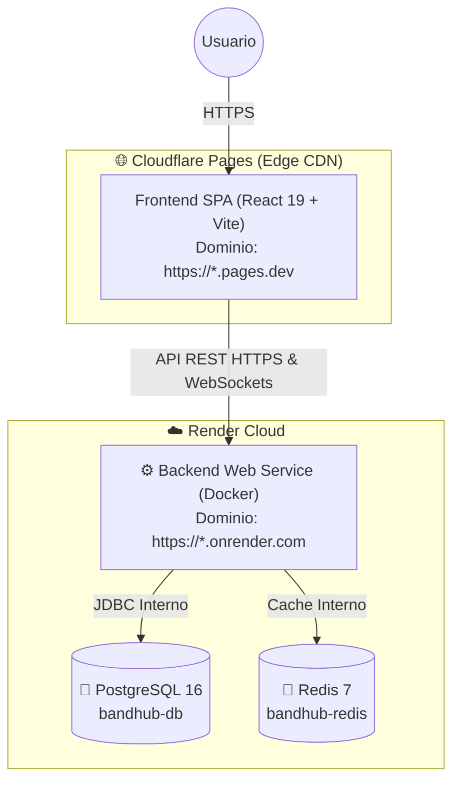

# 🚀 Guía de Despliegue: Frontend en Cloudflare Pages + Backend en Render

Esta guía detalla paso a paso cómo desplegar la plataforma **BandHub** con el Frontend (React + Vite) alojado globalmente en **Cloudflare Pages** y el Backend (Spring Boot 3 + PostgreSQL + Redis) en **Render**.

---

## 🏗️ Arquitectura de Despliegue

---

## 📋 Resumen de Ajustes Realizados en el Proyecto

1. **Cloudflare Pages SPA Routing**: Se añadió `frontend/public/_redirects` (`/* /index.html 200`) para que el refresco de rutas en React Router funcione sin error 404.
2. **WebSockets Dinámicos**: En `frontend/src/hooks/useWebSocket.ts`, el endpoint STOMP/SockJS ahora detecta automáticamente la URL del backend (`VITE_WS_URL` o derivado de `VITE_API_URL`), eliminando el `localhost:8080` hardcodeado.
3. **CORS para Cloudflare Pages**: El backend ya acepta por defecto orígenes `https://*.pages.dev` y `https://*.onrender.com` con credenciales habilitadas.
4. **Cookies de Refresh Token Cross-Site**: `AuthController` ahora configura `SameSite=None; Secure=true` en producción para que el navegador permita enviar cookies HttpOnly entre `pages.dev` y `onrender.com`.
5. **Memoria Optimizada en Render**: `backend/Dockerfile` tiene configurado `-XX:+UseContainerSupport -XX:MaxRAMPercentage=75.0` para no exceder los 512 MB del Free Tier de Render.
6. **Infraestructura como Código**: Se incluyó `render.yaml` para aprovisionar Backend + PostgreSQL + Redis en 1 solo clic mediante Blueprints de Render.

---

## ⚙️ PARTE 1: Desplegar el Backend en Render

Tienes **dos opciones**: usar el Blueprint automático (`render.yaml`) o crearlo manualmente desde la interfaz de Render.

### Opción A (Recomendada): Vía Blueprint (`render.yaml`)

1. Haz push de tus cambios a GitHub (`git add . && git commit -m "feat: config render y cloudflare" && git push`).
2. Entra a tu cuenta en [dashboard.render.com](https://dashboard.render.com).
3. Haz clic en **New +** ➔ **Blueprint**.
4. Conecta tu repositorio de GitHub (`kevinKfv/musica`).
5. Render detectará el archivo `render.yaml` y mostrará los 3 recursos a crear:
   - **bandhub-db** (PostgreSQL)
   - **bandhub-redis** (Redis Private Service)
   - **bandhub-backend** (Web Service Docker)
6. Haz clic en **Apply**. Render provisionará la base de datos, el Redis y compilará la imagen Docker del backend.
7. Al terminar el build, copia la URL pública de tu backend (ejemplo: `https://bandhub-backend-xxxx.onrender.com`).

---

### Opción B: Creación Manual en Render

Si prefieres crearlo paso a paso desde el panel:

#### 1. Crear PostgreSQL
1. En Render, clic en **New +** ➔ **PostgreSQL**.
2. **Name**: `bandhub-db`.
3. **Database**: `bandhub_db`.
4. **User**: `bandhub_user`.
5. **Plan**: `Free`.
6. Clic en **Create Database**. Guarda los datos de conexión interna (`Internal Database URL`, `Host`, `Password`, etc.).

#### 2. Crear Redis
1. En Render, clic en **New +** ➔ **Private Service**.
2. Selecciona **Existing image**.
3. **Image URL**: `redis:7-alpine`.
4. **Name**: `bandhub-redis`.
5. **Plan**: `Free`.
6. Clic en **Create Private Service**. Anota el host interno generado (ej: `bandhub-redis:6379`).

#### 3. Crear Web Service (Backend Spring Boot)
1. Clic en **New +** ➔ **Web Service**.
2. Conecta tu repositorio GitHub.
3. Configuración:
   - **Name**: `bandhub-backend`
   - **Region**: La misma que la base de datos (ej: `Oregon`)
   - **Runtime**: `Docker`
   - **Dockerfile Path**: `./backend/Dockerfile`
   - **Docker Context**: `./backend`
   - **Plan**: `Free`
   - **Health Check Path**: `/actuator/health`
4. En **Environment Variables**, añade:

| Clave | Valor |
|---|---|
| `PORT` | `8080` |
| `SPRING_PROFILES_ACTIVE` | `prod` |
| `SPRING_DATASOURCE_URL` | `jdbc:postgresql://<Internal-Host-Postgres>:5432/bandhub_db` |
| `SPRING_DATASOURCE_USERNAME` | `bandhub_user` |
| `SPRING_DATASOURCE_PASSWORD` | `<Password-de-tu-Postgres>` |
| `SPRING_DATA_REDIS_HOST` | `bandhub-redis` |
| `SPRING_DATA_REDIS_PORT` | `6379` |
| `JWT_SECRET` | Genera una cadena aleatoria de 64 caracteres |
| `CORS_ALLOWED_ORIGINS` | `https://*.pages.dev,http://localhost:5173` |
| `COOKIE_SECURE` | `true` |
| `COOKIE_SAME_SITE` | `None` |

5. Clic en **Create Web Service**.
6. Copia tu URL pública generada (ej: `https://bandhub-backend.onrender.com`).

---

## 🌐 PARTE 2: Desplegar el Frontend en Cloudflare Pages

1. Inicia sesión en [dash.cloudflare.com](https://dash.cloudflare.com).
2. Ve a la sección **Workers & Pages** en el menú lateral.
3. Haz clic en **Create Application** ➔ Pestaña **Pages** ➔ **Connect to Git**.
4. Selecciona tu repositorio GitHub `kevinKfv/musica`.
5. Configura los parámetros de build:
   - **Project Name**: `bandhub` (o el nombre que prefieras).
   - **Production Branch**: `main` (o tu rama principal).
   - **Framework Preset**: `Vite`.
   - **Root directory**: `frontend`.
   - **Build command**: `npm run build`.
   - **Build output directory**: `dist`.
6. Despliega la sección **Environment variables (advanced)** y añade:

| Variable | Valor |
|---|---|
| `VITE_API_URL` | `https://bandhub-backend-xxxx.onrender.com/api/v1` *(la URL de tu backend en Render)* |
| `NODE_VERSION` | `20` *(para asegurar compatibilidad con Node LTS moderno)* |

7. Haz clic en **Save and Deploy**.
8. Cloudflare compilará el frontend en ~1 minuto y te dará una URL como `https://bandhub.pages.dev`.

---

## 🧪 PARTE 3: Verificación y Pruebas

1. **Health Check del Backend**:
   Visita en tu navegador:
   `https://<tu-backend>.onrender.com/actuator/health`
   Debe responder `{"status":"UP"}`.

2. **Swagger / OpenAPI**:
   Visita:
   `https://<tu-backend>.onrender.com/swagger-ui.html`

3. **Navegación en Frontend**:
   Entra a tu dominio de Cloudflare (`https://bandhub.pages.dev`), navega a `/login` o `/explore` y recarga la página con F5. Gracias a `_redirects`, no habrá error 404.

4. **Autenticación y Cookies Cross-Site**:
   Inicia sesión. Inspecciona en las DevTools del navegador (**Application** ➔ **Cookies**) que la cookie `refreshToken` tenga los atributos `HttpOnly`, `Secure` y `SameSite=None`.

---

## 💡 Notas Importantes y Limitaciones (Render Free Tier)

> ⚠️ **Spin-down por inactividad**: El plan gratuito de Render suspende los Web Services tras 15 minutos sin tráfico. La primera petición tras una pausa puede tardar entre 40 y 50 segundos en despertar (cold start). Esto es normal en el Free Tier de Render.
>
> ⚠️ **Límite de 512 MB de RAM**: Con la bandera `-XX:MaxRAMPercentage=75.0` ya configurada en el Dockerfile, la JVM de Java 21 se mantendrá controlada en torno a los ~380 MB para evitar el error *Out of Memory (Exit Code 137)*.
