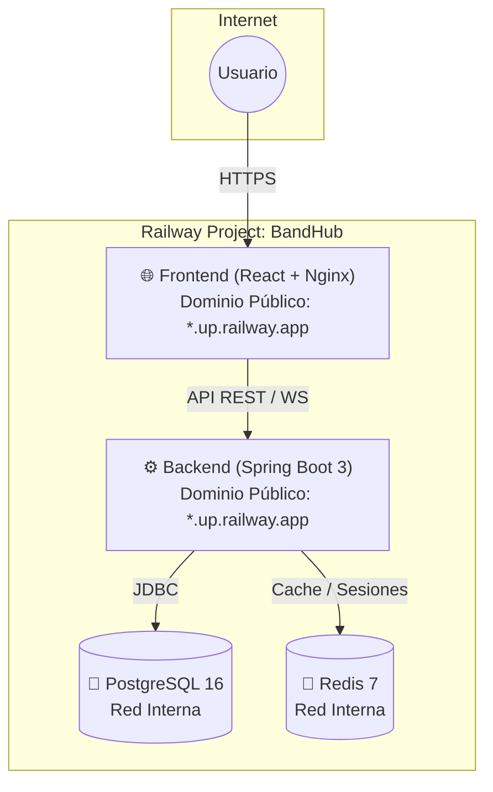

# 🚀 Guía Paso a Paso: Despliegue de BandHub en Railway

Esta guía explica en detalle cómo desplegar la plataforma **BandHub** (Backend Spring Boot 3 + PostgreSQL + Redis + Frontend React 19 SPA) en [Railway](https://railway.app).

---

## 🏗️ Arquitectura de Despliegue en Railway

El proyecto en Railway se compone de **4 servicios conectados**:



---

## 📋 Requisitos Previos

1. Cuenta activa en [Railway.app](https://railway.app).
2. El repositorio subido a GitHub: [`https://github.com/kevinKfv/musica`](https://github.com/kevinKfv/musica).

---

## 🛠️ Paso 1: Crear un Nuevo Proyecto en Railway

1. Entra a tu dashboard en [railway.app](https://railway.app/dashboard).
2. Haz clic en el botón **`+ New Project`**.
3. Selecciona **`Empty project`** (o nómbralo `bandhub`).

---

## 🐘 Paso 2: Crear la Base de Datos PostgreSQL

1. Dentro de tu proyecto en Railway, haz clic en **`+ New`** o presiona `Ctrl + K`.
2. Selecciona **`Database`** ➔ **`Add PostgreSQL`**.
3. Railway creará el contenedor de PostgreSQL automáticamente en segundos.
4. *(Opcional)* Haz clic sobre el servicio PostgreSQL y renómbralo a `Postgres` para mayor claridad.
5. Railway genera automáticamente las credenciales internas (`PGHOST`, `PGPORT`, `PGUSER`, `PGPASSWORD`, `PGDATABASE`, `DATABASE_URL`).

> ℹ️ **Nota sobre los esquemas:** BandHub utiliza Flyway con migraciones automáticas (`V1` a `V13`). Cada script incluye `CREATE SCHEMA IF NOT EXISTS schema_...`, por lo que todos los esquemas (`schema_auth`, `schema_users`, `schema_bands`, etc.) se crearán automáticamente en el primer inicio del backend sin intervención manual.

---

## 🔴 Paso 3: Crear el Servicio de Redis

1. En el mismo proyecto, haz clic en **`+ New`** o presiona `Ctrl + K`.
2. Selecciona **`Database`** ➔ **`Add Redis`**.
3. Railway provisionará el servicio Redis al instante.
4. *(Opcional)* Renómbralo a `Redis`.
5. Railway genera automáticamente `REDISHOST`, `REDISPORT`, `REDISPASSWORD`, `REDISUSER`.

---

## ⚙️ Paso 4: Desplegar el Backend (Spring Boot)

1. En el mismo proyecto, haz clic en **`+ New`** ➔ **`GitHub Repo`**.
2. Selecciona el repositorio **`kevinKfv/musica`**.
3. Railway creará el servicio. Antes de que termine el primer intento de build, haz clic en el servicio y ve a la pestaña **`Settings`**:
   - **Service Name**: Cámbialo a `backend` (o `bandhub-backend`).
   - **Root Directory**: Escribe `/backend` y haz clic en el check verde para guardar.
   - **Build**: Railway detectará automáticamente el archivo `Dockerfile` dentro de `/backend`.
4. Ve a la pestaña **`Variables`** del servicio Backend y añade las siguientes variables:

| Variable | Valor sugerido / Referencia Railway | Descripción |
|---|---|---|
| `SPRING_DATASOURCE_URL` | `jdbc:postgresql://${{Postgres.PGHOST}}:${{Postgres.PGPORT}}/${{Postgres.PGDATABASE}}` | Conexión JDBC interna a Postgres |
| `SPRING_DATASOURCE_USERNAME` | `${{Postgres.PGUSER}}` | Usuario de Postgres |
| `SPRING_DATASOURCE_PASSWORD` | `${{Postgres.PGPASSWORD}}` | Contraseña de Postgres |
| `SPRING_DATA_REDIS_HOST` | `${{Redis.REDISHOST}}` | Host interno de Redis |
| `SPRING_DATA_REDIS_PORT` | `${{Redis.REDISPORT}}` | Puerto de Redis (usualmente 6379) |
| `SPRING_DATA_REDIS_PASSWORD` | `${{Redis.REDISPASSWORD}}` | Contraseña de Redis |
| `JWT_SECRET` | `404E635266556A586E3272357538782F413F4428472B4B6250645367566B5970` | Clave secreta para firmar tokens JWT (64 caracteres) |
| `CORS_ALLOWED_ORIGINS` | `https://*.up.railway.app,https://*.railway.app,http://localhost:5173` | Orígenes CORS permitidos |
| `SPRING_PROFILES_ACTIVE` | `prod` | Perfil activo de Spring |

5. Ve a la pestaña **`Settings`** ➔ Sección **`Networking`**:
   - En **Public Networking**, haz clic en **`Generate Domain`**.
   - Railway te asignará un dominio público, por ejemplo:
     `https://bandhub-backend-production.up.railway.app`
   - **Copia este dominio**, lo necesitarás en el paso del Frontend.

6. Haz clic en **`Deploy`** (o redeploy) para compilar y arrancar el backend.
7. Verifica en **`Deployments`** ➔ **`View Logs`** que Spring Boot inicia con:
   ```text
   Started BandHubApplication in X.XXX seconds
   ```

---

## 🌐 Paso 5: Desplegar el Frontend (React 19 + Vite)

1. En el mismo proyecto, haz clic en **`+ New`** ➔ **`GitHub Repo`**.
2. Selecciona de nuevo el repositorio **`kevinKfv/musica`**.
3. Haz clic en el nuevo servicio y ve a la pestaña **`Settings`**:
   - **Service Name**: Cámbialo a `frontend` (o `bandhub-frontend`).
   - **Root Directory**: Escribe `/frontend` y guarda.
   - **Build**: Detectará el archivo `frontend/Dockerfile` de producción (multi-stage build con Nginx y soporte SPA).
4. Ve a la pestaña **`Variables`** del servicio Frontend y añade:

| Variable | Valor | Descripción |
|---|---|---|
| `VITE_API_URL` | `https://TU-BACKEND.up.railway.app/api/v1` | URL pública del Backend obtenida en el Paso 4 |

> ⚠️ **IMPORTANTE:** `VITE_API_URL` se incrusta durante la compilación (`npm run build`). Si cambias el dominio del backend más adelante, deberás redeployar el frontend.

5. Ve a la pestaña **`Settings`** ➔ Sección **`Networking`**:
   - Haz clic en **`Generate Domain`**.
   - Railway generará la URL pública de la aplicación, por ejemplo:
     `https://bandhub-frontend-production.up.railway.app`

6. Railway compilará el frontend y levantará el servidor Nginx en cuestión de minutos.

---

## ✅ Paso 6: Verificación y Pruebas

1. **Documentación Swagger UI (Backend):**
   - Entra a `https://TU-BACKEND.up.railway.app/swagger-ui.html`.
   - Deberás ver todos los endpoints de BandHub organizados por módulo.
2. **Healthcheck del Backend:**
   - Entra a `https://TU-BACKEND.up.railway.app/actuator/health` (debe responder `{"status":"UP"}`).
3. **Frontend:**
   - Abre la URL pública del frontend (`https://TU-FRONTEND.up.railway.app`).
   - Prueba el Registro o Login de un usuario.
   - Navega por las secciones (Lugares, Academia, Agenda, Biblioteca) verificando que las peticiones se completan sin errores de red ni de CORS.

---

## 🔧 Solución de Problemas Frecuentes

### 1. Error de CORS en el navegador al hacer login
- **Causa**: El backend no reconoce el dominio de tu frontend.
- **Solución**: En el servicio `backend`, ve a **Variables** y añade a `CORS_ALLOWED_ORIGINS` la URL exacta de tu frontend (ejemplo: `https://bandhub-frontend-production.up.railway.app`). Luego haz redeploy del backend.

### 2. Error `Connection refused` a PostgreSQL
- **Causa**: La variable `SPRING_DATASOURCE_URL` no está resolviendo el host interno.
- **Solución**: Usa la sintaxis de variables de referencia de Railway:
  `jdbc:postgresql://${{Postgres.PGHOST}}:${{Postgres.PGPORT}}/${{Postgres.PGDATABASE}}`
  Asegúrate de que el nombre del servicio de la base de datos coincida con el nombre referenciado (por ejemplo `Postgres`).

### 3. Error 404 al refrescar una página en el Frontend
- **Solución**: Nuestro `frontend/Dockerfile` ya incluye una plantilla de Nginx configurada con `try_files $uri $uri/ /index.html;`, por lo que el enrutamiento client-side de React Router funciona perfectamente ante recargas de página.
